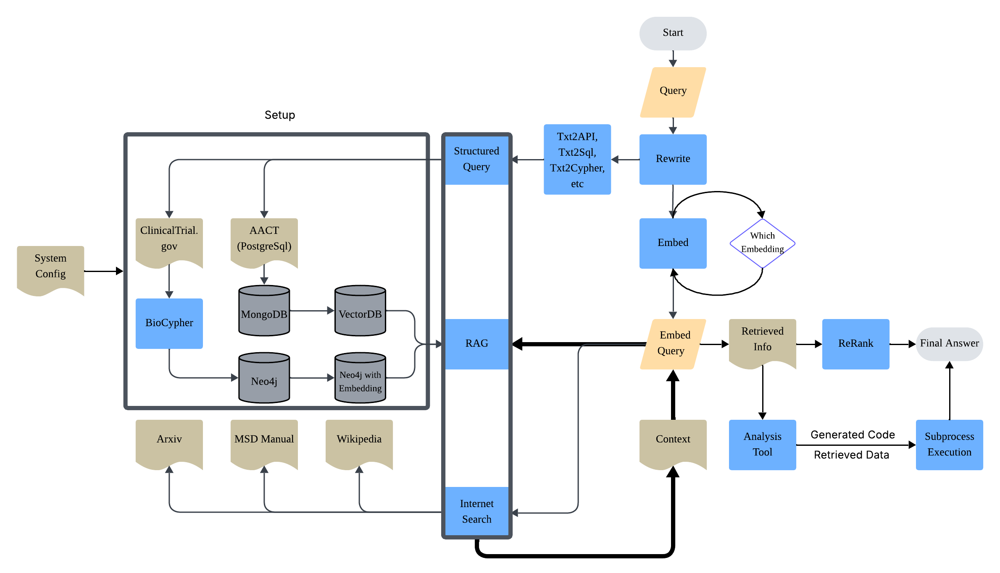

## HippoView

HippoView is an AI-powered clinical trial explorer. It combines:

1. A clinical trial data layer backed by MongoDB, Neo4j, and Elasticsearch.
2. A GraphRAG/MCP service that exposes clinical trial retrieval tools.
3. A Streamlit UI for asking questions through an agent.



## Services

The local Docker Compose stack starts the full test environment:

| Service | Purpose | Local URL |
| --- | --- | --- |
| `streamlit` | Web UI | http://localhost:8501 |
| `mcp_server` | Main RAG/MCP service | http://localhost:8000/mcp |
| `mongodb` | Trial document store | localhost:27017 |
| `neo4j` | Knowledge graph | http://localhost:7474 |
| `elasticsearch` | Vector index | http://localhost:9200 |

## Test Run Guide

### 1. Configure local variables

Edit `docker-variables.env` before the first run.

At minimum, choose the LLM provider you will use in the Streamlit sidebar and fill the matching key:

```env
DEEPSEEK_API_KEY=
OPENAI_API_KEY=
MISTRAL_API_KEY=
ANTHROPIC_API_KEY=
GOOGLE_API_KEY=
```

The default database credentials and ports are already set for local testing.

### 2. Start the whole stack

```bash
docker compose --env-file docker-variables.env up --build
```

This builds the local HippoView app image and starts the UI, MCP service, MongoDB, Neo4j, and Elasticsearch together.

For detached mode:

```bash
docker compose --env-file docker-variables.env up --build -d
```

The default images in `docker-variables.env` use public ECR to avoid Docker Hub `auth.docker.io` token timeouts:

```env
PYTHON_BUILDER_IMAGE=public.ecr.aws/docker/library/python:3.12
PYTHON_RUNTIME_IMAGE=public.ecr.aws/docker/library/python:3.12-slim
MONGODB_IMAGE=public.ecr.aws/docker/library/mongo:7.0
NEO4J_IMAGE=public.ecr.aws/docker/library/neo4j:5.15-community
ELASTICSEARCH_IMAGE=public.ecr.aws/docker/library/elasticsearch:8.11.0
```

If one registry is slow on your network, replace only these image values and rerun the same Compose command.

### 3. Check service health

```bash
docker compose --env-file docker-variables.env ps
```

Useful logs:

```bash
docker compose --env-file docker-variables.env logs -f mcp_server
docker compose --env-file docker-variables.env logs -f streamlit
```

### 4. Open the UI

Open http://localhost:8501.

In the Streamlit sidebar:

1. Keep `Agent Type` as `ReAct LG with MCP`.
2. Select the LLM provider whose API key you configured.
3. Confirm the MCP URL is `http://mcp_server:8000/mcp`.
4. Click `Check MCP Server Status`.
5. Click `Initialize Agent`.

### 5. Load trial data when needed

The stack can start with empty databases, but useful RAG answers require trial data in MongoDB, Neo4j, and Elasticsearch.

To load a small MongoDB sample from AACT, fill `AACT_USER` and `AACT_PWD` in `docker-variables.env`, then run:

```bash
docker compose --env-file docker-variables.env exec mcp_server \
  python data/load2mongo.py --nct-ids-file data/filtered_nct_ids.csv --max-trials 50
```

If MongoDB has no trials, the MCP service still starts, but vector search tools will report that no trials were found.

### 6. Stop or reset

Stop containers while keeping database volumes:

```bash
docker compose --env-file docker-variables.env down
```

Reset local database volumes:

```bash
docker compose --env-file docker-variables.env down -v
```

## Development Notes

Run Streamlit directly on the host only when debugging Python code outside Docker:

```bash
source venv/bin/activate
./run_streamlit.sh
```

For the normal test path, prefer Docker Compose so the UI, main MCP service, and databases use the same service names and environment.

## Troubleshooting

- If image pulls time out, retry the Compose command or change the image variables in `docker-variables.env` to a registry that is faster on your network.
- If `Initialize Agent` fails, check that the selected LLM provider has a key in `docker-variables.env`.
- If MCP status fails in Docker, the UI should use `http://mcp_server:8000/mcp`, not `localhost`.
- If search returns no results, load trial data first and restart `mcp_server` if needed.
